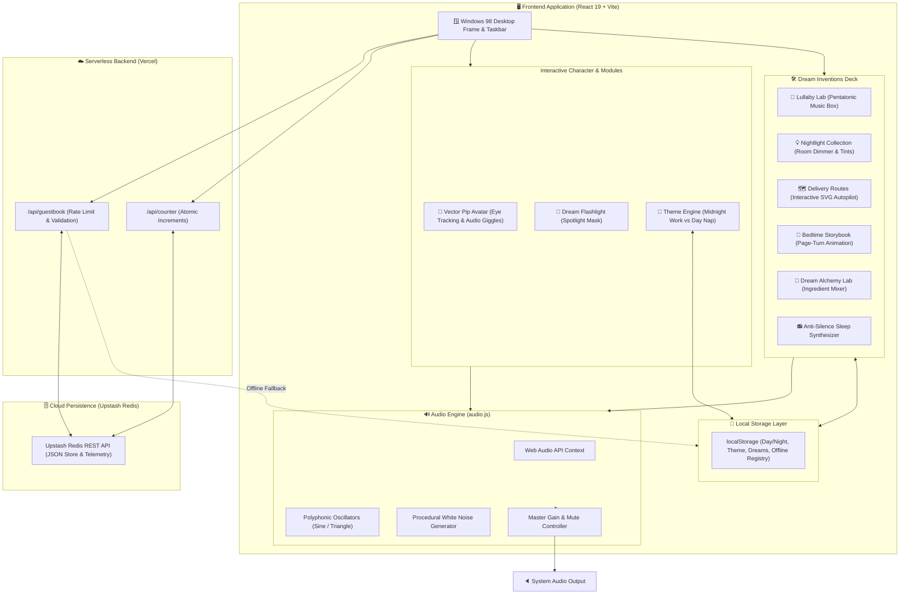
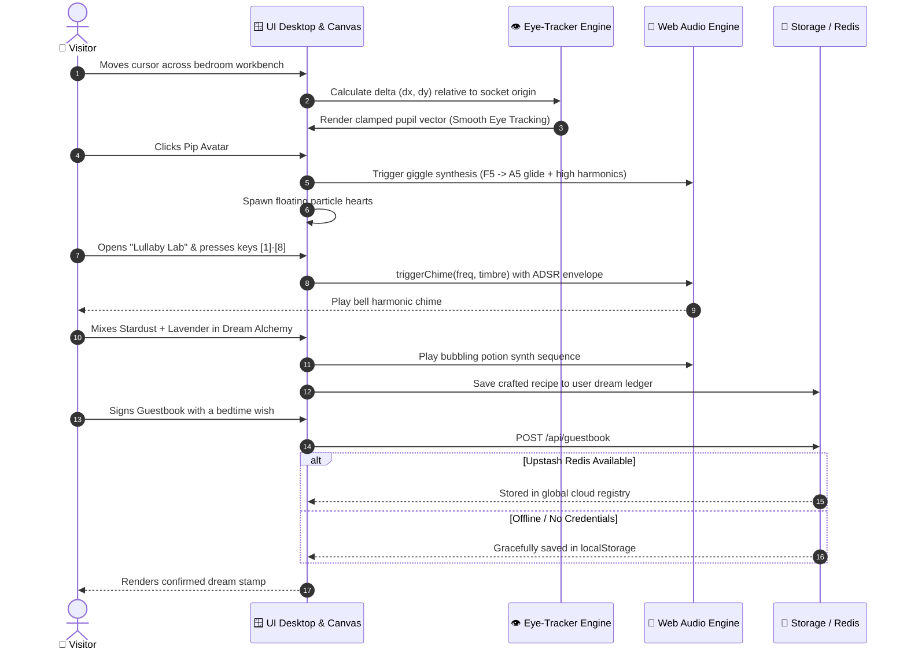
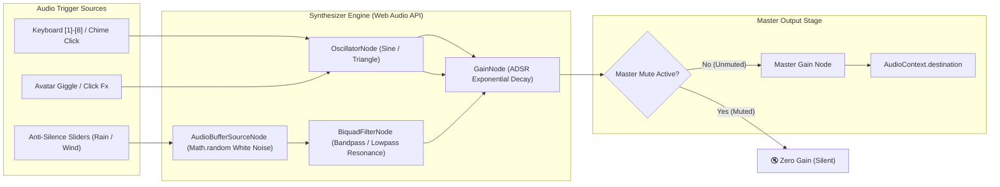

<div align="center">

# 🌙 Pip's Bedtime Homepage
### *Track 1: "Same Baby, 1,000 Websites" · haX.baby Hackathon*

[](https://react.dev/)
[](https://vite.dev/)
[](https://developer.mozilla.org/en-US/docs/Web/API/Web_Audio_API)
[](https://upstash.com/)
[](https://vercel.com/)
[](LICENSE)

> **"I build the dreams you fall asleep inside."**  
> *Pip · Junior Dream Engineer at the Midnight Nursery*

[Architecture Flow](#-system-architecture) • [User Flow](#-user-journey--interactive-flow) • [Features Matrix](#-core-features--inventions-matrix) • [Audio Engine](#-web-audio-synthesis-pipeline) • [Quickstart](#-quickstart--local-development)

</div>

---

## 📌 Executive Overview

**Pip's Bedtime Homepage** is an interactive, story-driven web application crafted for the **haX.baby Hackathon (Track 1)**. It marries **authentic 90s early-web soul** (Windows 98 beveled window manager, mechanical hit odometer, retro marquees, and nostalgic webrings) with **modern frontend engineering**:

- 👁️ **Mathematical Vector Eye-Tracking**: Real-time cursor coordinates translated into clamped pupil vector trajectories.
- 🎹 **Zero-Asset Web Audio Synthesizer**: Polyphonic pentatonic music box, procedural white-noise rain, wind generators, and low-frequency dream drones.
- 🧪 **Dream Alchemy Cauldron**: Interactive mixer combining starlight ingredients with real-time sound feedback and local dream ledger persistence.
- ☁️ **Resilient Full-Stack Slumber Registry**: Serverless guestbook with Upstash Redis REST database and offline `localStorage` fallback.

---

## 🏗️ System Architecture

The following diagram illustrates the end-to-end component hierarchy, audio routing, and persistent data layer:



---

## 🔄 User Journey & Interactive Flow

This sequence flow describes the interactive lifecycle as visitors explore Pip's bedroom workbench:



---

## 🔊 Web Audio Synthesis Pipeline

Pip **hates silence**, so every acoustic element is generated algorithmically in real-time in the browser without loading heavy external sound files:



---

## 📊 Core Features & Inventions Matrix

| Invention / Module | Technology | Canon Alignment | Interactive Highlights |
| :--- | :--- | :--- | :--- |
| **👶 Pip Avatar** | SVG Vectors + Math Trajectories | *Baby Dream Engineer* | Eyes follow cursor; giggle sound + floating hearts on click. |
| **🎵 Lullaby Lab** | Web Audio API (ADSR Envelopes) | *Hates silence* | 8 pentatonic chime bells (`C` to `E²`), keyboard hotkeys `[1]`-`[8]`, 3 sound timbres, melody auto-player. |
| **💡 Nightlight Collection** | CSS Custom Properties + SVG | *Soothes restless rooms* | 4 bedside lamps, dynamic room illumination slider (10%-100%), spectral color tints. |
| **🗺️ Delivery Routes** | SVG Path Interpolation | *Midnight cloud delivery* | Chimney flight tracker, interactive timeline scrubber, and delivery run autopilot. |
| **📖 Bedtime Storybook** | 3D CSS Transforms | *Origins lore* | *"The Boy Who Lost His Yawn"* with realistic page-turning, arrow keys, and touch swipe. |
| **🧪 Dream Alchemy Lab** | Reactive State + Audio Synth | *Dream formulation* | 8 starlight ingredients to brew custom recipes; saves dream ledger locally. |
| **📻 Anti-Silence Machine** | Procedural Noise + Audio Filters | *Core character quirk* | Procedural rainfall, wind gusts, and star drones with volume mixing. |
| **🔦 Dream Flashlight** | Dynamic Radial Mask | *Secret night nursery* | Uncovers hidden nursery stickers and constellations across the dark canvas. |
| **💌 Slumber Registry** | Serverless + Redis REST | *Community wishes* | Full-stack guestbook with rate-limiting and offline localStorage fallback. |

---

## 📁 Repository Directory Structure

```text
pips-bedtime-homepage/
├── api/                             # Serverless backend functions
│   ├── counter.js                   # Atomic telemetry visitor hit counter
│   └── guestbook.js                 # Upstash Redis REST guestbook handler
├── public/
│   ├── assets/                      # Official character reference assets
│   ├── favicon.svg                  # Nightcap icon
│   └── icons.svg                    # Vector iconography
├── src/
│   ├── assets/                      # Static branding assets
│   ├── components/
│   │   ├── AntiSilenceMachine.jsx   # Ambient sleep sound synthesizer
│   │   ├── DreamAlchemyLab.jsx      # Dream potion crafting workshop
│   │   ├── DreamFlashlight.jsx      # Dark mode spotlight mask
│   │   ├── DreamGuestbook.jsx       # Slumber registry community board
│   │   ├── HitCounter.jsx           # 6-digit mechanical roll-over odometer
│   │   ├── PipAvatar.jsx            # Cursor-tracking vector character
│   │   ├── PipBioWindow.jsx         # Windows 98 personnel dossier
│   │   ├── RetroWebring.jsx         # 90s webring & hackathon credentials
│   │   ├── SecretModal.jsx          # Easter egg unlock dialog
│   │   ├── SecretMoonEasterEgg.jsx  # 3-click crescent moon listener
│   │   ├── SparkleTrail.jsx         # Accessible stardust cursor trail
│   │   ├── StoryScenes.jsx          # 5-act illustrated origin chronicle
│   │   └── projects/
│   │       ├── BedtimeStorybook.jsx # Interactive picture book
│   │       ├── DreamDeliveryRoutes.jsx # SVG flight map & autopilot
│   │       ├── LullabyLab.jsx       # Web Audio pentatonic chime box
│   │       └── NightlightCollection.jsx # Dimmable lantern showroom
│   ├── utils/
│   │   └── audio.js                 # Pure Web Audio synthesis engine
│   ├── App.jsx                      # Root desktop layout & event conductor
│   ├── index.css                    # Design system (Win98 tokens & palettes)
│   └── main.jsx                     # Application entry point
├── package.json                     # Dependency manifests
├── vercel.json                      # Vercel deployment & routing config
└── vite.config.js                   # Vite build configuration
```

---

## 🚀 Quickstart & Local Development

### Prerequisites
- **Node.js** `v18.0.0` or higher
- **npm** `v9.0.0` or higher

### Installation & Run
```bash
# 1. Clone the repository
git clone https://github.com/shravani-162006/pips-bedtime-homepage.git

# 2. Enter project directory
cd pips-bedtime-homepage

# 3. Install dependencies
npm install

# 4. Launch local development server
npm run dev
```

Open your browser to: **`http://localhost:5173`**

### Production Build & Preview
```bash
# Build optimized production bundle
npm run build

# Preview production build locally
npm run preview
```

---

## ⚙️ Environment Variables (Optional)

The application functions **100% offline and locally out of the box** using `localStorage` caching. To enable live multi-user cloud persistence when deploying to Vercel:

| Variable | Required | Description |
| :--- | :---: | :--- |
| `UPSTASH_REDIS_REST_URL` | No | REST endpoint URL from [console.upstash.com](https://console.upstash.com) |
| `UPSTASH_REDIS_REST_TOKEN` | No | REST read/write authorization token from Upstash |

---

## ☁️ Deployment Guide

### Deploying to Vercel
1. Go to [vercel.com](https://vercel.com) and click **Add New Project**.
2. Select your imported GitHub repository `pips-bedtime-homepage`.
3. Framework preset: **Vite** (auto-detected).
4. *(Optional)* Add `UPSTASH_REDIS_REST_URL` and `UPSTASH_REDIS_REST_TOKEN` under Environment Variables.
5. Click **Deploy**.

---

## 📜 Credits & Hackathon Attributions
- **Character Concept & Lore:** haX.baby ("Baby's First Website" Hackathon, Track 1: Pip).
- **Official 3D Assets:** haX.baby Track 1 Creator Asset Pack.
- **Interactive Art:** Custom SVG vector Pip avatar and animation created specifically for this build.
- **Typography:** Google Fonts (*Fredoka*, *Silkscreen*, *Quicksand*, *Caveat*).
- **Sound Synthesis:** Built with the HTML5 Web Audio API. Zero external audio downloads.
- **License:** Released under the [MIT License](LICENSE).
